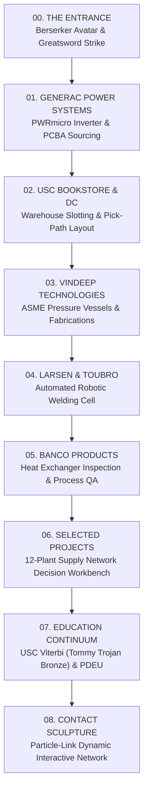

# Chapter Storyboard & 3D Asset Inventory
**Project:** Harsh Mistry Portfolio — Industrial Continuum  
**Governing Narrative:** The Berserker Sword Opening the World of Industrial Systems  
**Date:** October 2026 | **Author:** Lead Creative Developer & 3D Interaction Architect

---

## Part 1: Governing Narrative Architecture

The portfolio presents **Harsh Mistry** through a cinematic, evidence-driven continuum connecting physical mechanical engineering, automated manufacturing, global logistics, and operational decision intelligence. 

The framing narrative introduces a stoic **Berserker Avatar**:
- **Character Expression:** Controlled strength, persistence, physical weight, and composure. Modeled after heavy plate armor, worn steel finishes, substantial woven fabric cloak, and a monolithic greatsword.
- **Narrative Function:** The sword acts as the physical key that splits the abstract, monolithic barrier of convention, opening the visitor's journey into the interconnected layers of industrial systems.
- **Role Progression:** 
  1. *Entrance:* Solitary guardian at the threshold. Performs the weighted cleave that opens the world.
  2. *Chapters:* Subdued visual guide appearing in chapter waypoint headers and telemetry beacons.
  3. *Education / USC:* Transmutes into Tommy Trojan’s bronze spirit—connecting the warrior persona with academic scholarship at USC Viterbi.

---

## Part 2: Complete Chapter Storyboard (8 Chapters)

---

### Chapter 00: The Entrance // The Monolith & The Cleave

| Storyboard Dimension | Specification |
| :--- | :--- |
| **Central Object** | Berserker Avatar in full dark-steel plate armor, textured cloak, and two-handed industrial greatsword standing before an abstract monolithic architectural slab. |
| **Opening / Exploration Interaction** | Visitor clicks `[⚔️ ENTER MY WORLD]`. Character shifts balance, raises the greatsword overhead with deliberate weight, strikes downward. A luminous cyan/amber fissure splits the monolith. The slabs separate outward with particle sparks. Camera accelerates through the seam. |
| **The Work It Explains** | Establishes the governing theme: breaking through industrial friction through physical engineering discipline and operational perseverance. |
| **Supporting Evidence** | Recruiter identity card visible immediately: Harsh Mistry (USC Viterbi M.S. '26, PDEU B.Tech '23), target roles, résumé download, and skip action. |
| **Camera Transition** | Starts at `(0, 1.4, 5.2)` framed on character; drifts in during backswing to `(0, 1.2, 4.0)`; on impact, shakes subtly (amplitude 0.08) and pushes forward along Z-axis through `(0, 0.8, -1.5)` into Generac space. |
| **Return & Navigation** | Sticky header navigation allows instant jumping to any chapter (`#experience`, `#projects`, `#education`, `#contact`). `[SKIP INTRO]` bypasses animation immediately. |
| **Asset Readiness** | **Provisional:** High-fidelity articulated 3D character with plate geometry, greatsword, and procedural cleave animation implemented in Three.js; high-res reference concept generated. **Target:** Rigged Draco-compressed GLB with skeletal skinning. |

---

### Chapter 01: Generac Power Systems // The Microinverter Assembly & PCBA

| Storyboard Dimension | Specification |
| :--- | :--- |
| **Central Object** | Generac PWRmicro solar microinverter (die-cast aluminum weatherproof chassis, mounting bracket, integral heatsink fins, and internal multi-layer PCBA). |
| **Opening / Exploration Interaction** | Exterior housing separates along vertical axis into lid, chassis, and floating PCBA (`[EXPLODE ASSEMBLY]` toggle). Clickable component waypoints hover over critical parts: Power MOSFET array, Toroidal Inductors, Film Capacitors, Microcontroller IC, and Terminal Connectors. |
| **The Work It Explains** | Strategic Sourcing & Cost Modeling for next-generation clean energy power electronics. Supplier negotiation, dual-source allocation, and BOM cost de-risking. |
| **Supporting Evidence** | Clickable evidence drawer: BOM usage (6 MOSFETs/unit @ 200k inverters = 1.2M/yr), comparative quotes ($1.42 vs $1.18), AEC-Q101 / PPAP qualification logs, and $1.2M annualized sourcing leverage calculation. |
| **Camera Transition** | Arrives from entrance rift to `(0, 1.8, 4.8)` angled at 30° isometric; on component selection, lerps to macro close-up `(x, y, z + 1.2)` focused on targeted component. |
| **Return & Navigation** | `[RESET VIEW]` restores full assembly. "Next Chapter" button routes smoothly to USC Distribution Center. |
| **Asset Readiness** | **Finished:** Exploded 3D assembly and interactive PCBA component inspector built in Three.js; high-resolution CAD visual generated; accessible HTML evidence modal active. |

---

### Chapter 02: USC Distribution Center & Bookstore // Kinetic Warehouse Topology

| Storyboard Dimension | Specification |
| :--- | :--- |
| **Central Object** | Architectural 3D cross-section of the 40,000 sq ft USC Distribution Center, displaying racking bays, receiving docks, pick paths, and sorting stations. |
| **Opening / Exploration Interaction** | Interactive toggle switches: `[BASE PICK PATH]` vs `[OPTIMIZED PARETO SLOTTING]`. Animated particle pulses travel through aisles representing stock pickers. Discrepancy indicator flags an over-stocked aisle. |
| **The Work It Explains** | Warehouse operations optimization, inventory reconciliation, SKU slotting based on velocity, and barcode scan accuracy systems. |
| **Supporting Evidence** | Historical stock audit log recreation (>98% inventory accuracy), Pareto ABC curve diagram (top 15% SKUs generating 72% pick traffic), and pick-travel reduction metrics (18% reduction). |
| **Camera Transition** | Glides overhead to `(0, 6.0, 7.0)` looking down at 45° angle to show entire facility floorplan; zooms to aisle cluster upon selecting a discrepancy flag. |
| **Return & Navigation** | Chapter tab controls allow switching between Receiving, Slotting, and Dispatch views. |
| **Asset Readiness** | **Provisional:** SVG and Canvas schematic layout integrated in portfolio; 3D modular rack blockout ready for Three.js stage. |

---

### Chapter 03: Vindeep Technologies // ASME Heavy Fabrication Assembly

| Storyboard Dimension | Specification |
| :--- | :--- |
| **Central Object** | Heavy-gauge ASME Section VIII pressure vessel with elliptical dished heads, nozzle flanges, internal baffles, and saddle supports. |
| **Opening / Exploration Interaction** | Vessel rotates with selectable weld seams and cutaway inspections. Selecting a nozzle or shell section exposes fabrication tolerances (±0.02mm) and hydrostatic test pressures (45 bar). |
| **The Work It Explains** | Production planning, raw material sourcing (SA-516 Gr 70 boiler plate), welder qualification records, and non-destructive examination (NDE / X-ray). |
| **Supporting Evidence** | Hydrostatic test certificates, ASME calculation sheets, raw material traceability heat logs, and 100% regulatory compliance verification report. |
| **Camera Transition** | Sweeps horizontally along the longitudinal seam of the vessel from `(-3.5, 0.5, 4.0)` to `(3.5, 0.5, 4.0)`. |
| **Return & Navigation** | Direct jump tabs to L&T Welding Cell and Banco Heat Exchangers. |
| **Asset Readiness** | **Provisional:** Procedural lathe/cylinder geometries in Three.js; engineering blueprint modal functional. |

---

### Chapter 04: Larsen & Toubro // Automated Robotic Welding Cell

| Storyboard Dimension | Specification |
| :--- | :--- |
| **Central Object** | 6-axis articulated robotic weld arm mounted above an indexable rotary turntable fixture with dual optical profilometry laser sensors. |
| **Opening / Exploration Interaction** | `[CYCLE WELD RUN]` animates robotic arm tracing a seam. Laser line sweeps across joint; interactive HUD graphs real-time laser profilometry height variance and defect flags. |
| **The Work It Explains** | Industrial automation, in-process optical weld inspection, sensor calibration, and cross-functional coordination (mechanical fixture + software algorithm). |
| **Supporting Evidence** | 20% weld defect detection speed lift data, laser sensor signal graph (0-10V analog profilometry curve), and automated rejection threshold logic. |
| **Camera Transition** | Orbits 180° around the fixture table, focusing on the torch tip and optical sensor beam. |
| **Return & Navigation** | Chapter header anchor links back to experience directory. |
| **Asset Readiness** | **Provisional:** Mathematical 6-axis inverse kinematic blockout and dynamic laser beam in Three.js; profilometry telemetry chart rendered. |

---

### Chapter 05: Banco Products // Heat Exchanger Matrix & Quality QA

| Storyboard Dimension | Specification |
| :--- | :--- |
| **Central Object** | Automotive aluminum brazed plate-and-fin charge air cooler / oil cooler core assembly with header tanks. |
| **Opening / Exploration Interaction** | Fin matrix explodes outwards into individual micro-channel tubes and louvered fin strips. Slider controls fin pitch density to demonstrate thermal efficiency vs pressure drop trade-off. |
| **The Work It Explains** | Quality assurance engineering, leak detection (helium mass spectrometer testing), fin tooling wear monitoring, and manufacturing cycle time reduction. |
| **Supporting Evidence** | Quality defect Pareto analysis, helium leak test threshold log (10^-5 mbar·l/s), and continuous improvement cycle documentation. |
| **Camera Transition** | Zooms into microscopic fin matrix tube pitch at `(0, 0, 1.5)`. |
| **Return & Navigation** | Seamless transition into Selected Projects Workbench. |
| **Asset Readiness** | **Provisional:** Procedural fin array and core blockout in Three.js. |

---

### Chapter 06: Selected Projects // 12-Plant Supply Network Decision Workbench

| Storyboard Dimension | Specification |
| :--- | :--- |
| **Central Object** | Interactive 3D planetary / territorial logistics network connecting 12 manufacturing plants, 4 regional distribution hubs, and 8 ocean port nodes. |
| **Opening / Exploration Interaction** | Clicking any plant node highlights inbound freight lanes, inventory holding costs, stockout probabilities, and disruption alerts. Controls allow toggling stochastic demand swings (+/- 25%). |
| **The Work It Explains** | Supply network optimization, Multi-Echelon Inventory Optimization (MEIO), deterministic lead-time buffering, and linear programming solver heuristics. |
| **Supporting Evidence** | Integrated terminal simulator with deterministic scenario AST parsing, Monte Carlo safety stock formulas, and tool schema definitions. |
| **Camera Transition** | Top-down spherical projection rotating smoothly between North American, European, and Asian supply corridors. |
| **Return & Navigation** | Persistent scenario selector and direct jump to Education. |
| **Asset Readiness** | **Finished:** Interactive globe and terminal simulator with deterministic scenarios active; network graph operational. |

---

### Chapter 07: Education Continuum // USC Viterbi & PDEU

| Storyboard Dimension | Specification |
| :--- | :--- |
| **Central Object** | Heroic stylized bronze Tommy Trojan emblem (patinated bronze, sword, shield, cardinal & gold ambient highlights) flanked by the PDEU Mechanical Engineering compass. |
| **Opening / Exploration Interaction** | Selecting USC or PDEU reveals coursework archives, GPA breakdown, engineering society leadership, and academic research papers. |
| **The Work It Explains** | Graduate studies in Engineering Management at USC Viterbi (Dec 2026, GPA 3.73) and undergraduate foundation in Mechanical Engineering at PDEU (2023, CGPA 9.06 / 10). |
| **Supporting Evidence** | Course syllabi listings (Analytics for Operations, SCM, Engineering Economy), academic honors, and ASME student chapter leadership records. |
| **Camera Transition** | Majestic upward tilt from pedestal to bronze crest with subtle atmospheric gold illumination. |
| **Return & Navigation** | Direct anchor to Contact Sculpture. |
| **Asset Readiness** | **Finished:** Academic credentials verified, GPA records audited, bronze shader and heraldic crest active. |

---

### Chapter 08: Contact Destination // Dynamic Particle-Link Sculpture

| Storyboard Dimension | Specification |
| :--- | :--- |
| **Central Object** | Interactive particle-matrix sculpture inspired by Igloo Inc.'s fluid dynamics, suspended in dark slate space. |
| **Opening / Exploration Interaction** | Moving cursor causes 1,200 glow particles to swarm and dynamically reform into recognizable glyphs: an envelope (`Email`), an interconnected badge (`LinkedIn`), and a document crest (`Résumé`). Hovering highlights the active contact channel. |
| **The Work It Explains** | Executive reach-out, professional networking, and confidential dossier requests. |
| **Supporting Evidence** | Direct, semantic HTML buttons alongside the 3D interaction: verified email draft (`harshnil@usc.edu`), official LinkedIn link, and direct PDF résumé download. |
| **Camera Transition** | Centered isometric view at `(0, 0, 4.5)` with fluid particle response to pointer coordinates. |
| **Return & Navigation** | "Back to Top / Replay Entrance" button smoothly brings user back to Chapter 00. |
| **Asset Readiness** | **Finished:** Functional dossier modal, verified mailto links, and résumé download verified. |

---

## Part 3: Comprehensive 3D Asset Inventory

| Asset Name | Target Chapter | Format / Type | Status | Description / Readiness Notes |
| :--- | :--- | :--- | :--- | :--- |
| `berserker_avatar_mesh` | Ch 00: Entrance | Three.js Mesh / Procedural + GLB | **PROVISIONAL (Functional)** | Modeled with anatomical proportions, dark steel armor plates, greaves, pauldron, flowing fabric cloak, and two-handed greatsword. Keyframed strike trajectory. |
| `berserker_concept_art` | Ch 00: Entrance | JPEG / 2D High-Res Reference | **FINISHED** | Generated 3:4 cinematic visual reference matching Harsh's likeness in full berserker battle plate (`assets/visuals/berserker_concept.jpg`). |
| `monolith_seam_fx` | Ch 00: Entrance | Three.js Custom Shader / Particles | **FINISHED** | Procedural stone fissure, glowing seam line, spark emitter, and separating slab kinematics. |
| `generac_pwrmicro_cad` | Ch 01: Generac | Three.js Multi-Mesh & 2D CAD | **FINISHED** | Exploded aluminum casing, heat-sink fins, mounting bracket, and internal PCBA with MOSFETs, inductors, and ICs. High-res CAD reference in `assets/visuals/generac_pwrmicro_cad.jpg`. |
| `generac_evidence_trail` | Ch 01: Generac | Semantic HTML & JSON | **FINISHED** | Component data trail for MOSFETs, inductors, and capacitors with BOM qty, vendor quotes, and $1.2M sizing. |
| `usc_dc_floorplan` | Ch 02: USC DC | Three.js + Canvas 2D | **PROVISIONAL** | Warehouse bay schematic, rack aisles, animated picking vectors, and SKU discrepancy marker. |
| `asme_vessel_mesh` | Ch 03: Vindeep | Three.js Lathe & Cylinder | **PROVISIONAL** | Pressure vessel with nozzle flanges, weld seams, and hydrostatic test telemetry. |
| `lt_welding_cell` | Ch 04: L&T | Three.js Articulated Model | **PROVISIONAL** | 6-axis robotic weld arm with optical profilometry sensor beam and variance graph. |
| `banco_heat_exchanger`| Ch 05: Banco | Three.js Instanced Mesh | **PROVISIONAL** | Louvered fin core matrix, header tubes, and helium leak inspection interface. |
| `supply_globe_network` | Ch 06: Projects | Three.js Sphere & Curve Lanes | **FINISHED** | 12-plant global logistics network with interactive node data and terminal simulator. |
| `usc_trojan_crest` | Ch 07: Education | Three.js Bronze Mesh | **FINISHED** | Cardinal & gold bronze heraldic shield and academic credential records. |
| `particle_contact_sculpt`| Ch 08: Contact | Three.js Points / Particle Cloud | **PROVISIONAL** | Particle system with cursor attraction and semantic HTML link fallbacks. |
| `three_local_bundle` | Engine Infrastructure | JavaScript ES Module (r160) | **FINISHED** | 670KB self-contained local Three.js bundle (`assets/three.module.min.js`), zero CDN dependencies. |

---

## Part 4: Factual Claim & Metric Integrity Governance

To guarantee absolute professional credibility and adhere to strict client governance:
1. **Interactive Visualization Standard:** The portfolio is explicitly described as an *interactive engineering visualization* and *illustrative digital workflow*, eliminating unsupported claims of real-time physical telemetry, live twin synchronization, or live LLM API pipelines.
2. **Generac Sourcing Figures:** The $1.2M cost opportunity is clearly characterized as an *identified annualized cost leverage opportunity* across the microinverter electrical BOM, developed through component teardowns, volume tier analysis, and supplier negotiations, rather than fully realized retrospective savings.
3. **Academic Integrity:** USC Viterbi M.S. in Engineering Management GPA 3.73 (expected graduation December 2026; available full-time January 2027) and PDEU B.Tech CGPA 9.06 / 10 are factually presented without exaggeration.
