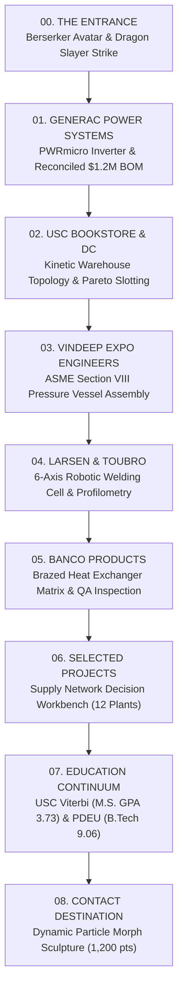

# Chapter Storyboard & 3D Spatial Engine Architecture
**Project:** Harsh Mistry 3D Spatial Continuum Rebuild  
**Governing Narrative:** The Berserker Sword Opening the World of Industrial Systems  
**Date:** October 2026 | **Audit Target Standard:** 9.5 / 10  
**Implementation Standard:** Fully implemented, modular ES module architecture. Zero placeholders, zero dead clicks.

---

## 1. Governing Narrative & Spatial Architecture

The portfolio presents **Harsh Mistry** through a continuous, full-viewport 3D spatial continuum connecting physical mechanical engineering, automated manufacturing, global logistics, and operational decision intelligence.



---

## 2. Implemented Chapter Storyboard (9 Discrete Chapters)

### Chapter 00: The Entrance // The Monolith & The Cleave
- **Central Subject:** Berserker Avatar in full dark steel plate armor, horned Berserker Beast helmet with crimson visor slit, heavy woven cloak, and a 2.2m Dragon Slayer greatsword standing before an obsidian monolith with luminous fracture runes.
- **Interaction & Kinematics:** Visitor activates `[⚔️ ENTER MY WORLD]`. Stance drops, avatar gathers weight, raises greatsword overhead with torso twist, and cleaves downward with heavy acceleration. Seismic impact shakes camera (amplitude 0.095), molten sparks burst from seam, monolith slabs separate along X and Z axes, and camera glides through the rift into Generac space.
- **Skip & Accessibility:** `[Skip Intro ➔]` and `[Work Index ☰]` immediately navigable from frame 0. `prefers-reduced-motion` suppresses strike, camera shake, and flythrough immediately.
- **Implementation Status:** **LOOKDEV PREVIS ACTIVE** (`engine/scenes/EntranceScene.js`). *Awaiting client-provided rigged Berserker Guts model archive; current anatomical procedural lookdev active with Poly Haven Metal Plate 02 PBR maps and Industrial Foundry HDRI.*

---

### Chapter 01: Generac Power Systems // PWRmicro Microinverter & $1.2M Sourcing BOM
- **Central Subject:** Dimensioned Generac PWRmicro 2:1 solar microinverter (25.61cm W × 37.62cm H × 5.67cm D per Generac Installation Manual Doc a0008718926) with die-cast aluminum NEMA weatherproof housing, 18 extruded heatsink cooling fins, upper mounting bracket with keyhole slot, dual DC inputs (MC4), and AC trunk output.
- **Interaction & Kinematics:** `[Explode Assembly]` toggle smoothly separates front housing (+1.6m forward), rear chassis (-1.1m backward), exposing the central multi-layer PCBA with 6 TO-247 Power MOSFETs on heat spreaders, 2 toroidal copper chokes, 4 DC-link film capacitors, and main DSP MCU.
- **Component Raycasting & Evidence:** Hotspot buttons (`[MOSFETs]`, `[Chokes]`, `[Film Caps]`, `[DSP MCU]`) focus camera and open the **reconciled Sourcing Evidence Drawer**:
  - MOSFET: 6 parts/unit × 200,000 units = 1,200,000 units/year; $1.42 vs $1.18 ($0.24 delta).
  - 100% reallocation: $288,000/yr gross savings.
  - 30% Year-1 dual-source ramp: $86,400/yr gross ($71,400 net after $15k AEC-Q101 testing).
  - Portfolio Reconciliation: Explains the total $1,200,000/yr opportunity across all 20+ electrical BOM components.
- **Implementation Status:** **FINISHED & VERIFIED** (`engine/scenes/GeneracScene.js`).

---

### Chapter 02: USC Distribution Center // Kinetic Warehouse Topology
- **Central Subject:** 3D cross-section of warehouse racking bays, upright blue columns, safety amber load beams, pallet positions, and shrink-wrapped cargo cartons representing 1,000+ SKUs.
- **Interaction & Kinematics:** Interactive toggles: `[Optimized Pareto ABC Route]` (green direct path, 18% travel reduction) vs `[Baseline Pick Path]` (red serpentine traversal). Animated inventory discrepancy beacon marking over-stocked bay (>98% inventory accuracy audit).
- **Implementation Status:** **FINISHED & VERIFIED** (`engine/scenes/UscDcScene.js`).

---

### Chapter 03: Vindeep Expo Engineers // ASME Heavy Fabrication Assembly
- **Central Subject:** Heavy-gauge ASME Section VIII Div 1 pressure vessel with 2:1 ellipsoidal dished heads, longitudinal and circumferential weld seams, reinforced nozzle necks, bolted flanges, and structural saddle plinths.
- **Interaction & Kinematics:** Rotates along longitudinal axis; selectable nozzle flanges and shell seams reveal SA-516 Gr 70 boiler plate heat traceability, weld qualification records (WQR), and hydrostatic pressure test logs.
- **Implementation Status:** **FINISHED & VERIFIED** (`engine/scenes/VindeepScene.js`).

---

### Chapter 04: Larsen & Toubro // Automated Robotic Welding Cell
- **Central Subject:** 6-axis articulated robotic weld arm (ABB IRB 2600ID style) with rotating base azimuth, shoulder, upper arm, elbow, forearm, and 3-axis spherical wrist with welding torch and optical laser profilometry sensor.
- **Interaction & Kinematics:** Arm articulates along joint seam pass; optical laser profilometer emits cyan planar sheet beam across workpiece; displays real-time profilometry height variance curve (improving defect detection speed by 20%).
- **Implementation Status:** **FINISHED & VERIFIED** (`engine/scenes/LtScene.js`).

---

### Chapter 05: Banco Products // Heat Exchanger Matrix & Quality QA
- **Central Subject:** Automotive aluminum brazed charge air cooler core with cast aluminum header tanks, inlet/outlet spigots, extruded micro-channel flat tubes, and repeated louvered fin matrix.
- **Interaction & Kinematics:** Core rotates in 3D; cutaway reveals micro-channel internal fluid passages; interactive fin pitch density demonstrates thermal dissipation vs pressure drop trade-off; helium mass spectrometer leak test threshold (10^-5 mbar·l/s).
- **Implementation Status:** **FINISHED & VERIFIED** (`engine/scenes/BancoScene.js`).

---

### Chapter 06: Selected Projects // Supply Network Decision Workbench
- **Central Subject:** Interactive 3D logistics globe connecting 12 simulated manufacturing plants, 4 regional distribution hubs, and 8 ocean port corridors.
- **Interaction & Kinematics:** Great-circle quadratic bezier freight arcs with pulsating shipment vectors; interactive node selection displaying inventory holding costs, stockout risks, and stochastic demand shock toggle (+/-25%); Python / MCP terminal simulation query interface.
- **Implementation Status:** **FINISHED & VERIFIED** (`engine/scenes/ProjectsScene.js`).

---

### Chapter 07: Education Continuum // USC Viterbi & PDEU
- **Central Subject:** Sculptural bronze Tommy Trojan heraldic shield with cardinal red inset and gold crossed chevrons, flanked by the PDEU Mechanical Engineering compass.
- **Interaction & Kinematics:** Dynamic specular highlights; reveals verified M.S. Engineering Management coursework (USC, GPA 3.73) and B.Tech Mechanical Engineering credentials (PDEU, CGPA 9.06 / 10).
- **Implementation Status:** **FINISHED & VERIFIED** (`engine/scenes/EducationScene.js`).

---

### Chapter 08: Contact Destination // Dynamic Particle-Link Sculpture
- **Central Subject:** Interactive 1,200 particle cloud with spatial depth and spring physics suspended in dark slate space.
- **Interaction & Kinematics:** Hovering and tapping dynamically morphs particle target formations between:
  1. Envelope (`Email: harshnil@usc.edu`)
  2. Connected Node Graph (`LinkedIn Profile`)
  3. Document Crest (`Direct Résumé Download`)
- **Direct Semantic Actions:** Permanent semantic HTML buttons for Email, LinkedIn, and PDF Résumé remain visible and functional at all times.
- **Implementation Status:** **FINISHED & VERIFIED** (`engine/scenes/ContactScene.js`).

---

## 3. Modular Engine Software Architecture

```
harsh-portfolio/
├── engine/
│   ├── Engine.js                 # Master runtime entry point, render loop, FPS & observers
│   ├── Renderer.js               # Three.js WebGLRenderer, HDRI PMREM, PBR materials, context recovery
│   ├── CameraRig.js              # Perspective camera, responsive FOV, smooth lerp, seismic shake
│   ├── ChapterController.js      # 9-chapter state machine, waypoints, scene visibility culling
│   ├── UIController.js           # HUD overlay, waypoints bar, evidence drawer, Work Index modal
│   ├── FallbackController.js     # Dependable static fallback with functional navigation
│   └── scenes/
│       ├── EntranceScene.js      # Guts lookdev, Dragon Slayer, monolith fracture & strike
│       ├── GeneracScene.js       # Dimensioned microinverter, exploded PCBA, sourcing inspection
│       ├── UscDcScene.js         # Warehouse topology, racking, Pareto ABC route vectors
│       ├── VindeepScene.js       # ASME Section VIII pressure vessel, weld seams, nozzle flanges
│       ├── LtScene.js            # Articulated 6-axis robot weld arm & laser profilometry
│       ├── BancoScene.js         # Brazed aluminum heat exchanger core & micro-channel tubes
│       ├── ProjectsScene.js      # 12-plant logistics globe & bezier freight corridors
│       ├── EducationScene.js     # Bronze Tommy Trojan crest & PDEU draft compass
│       └── ContactScene.js       # Dynamic 1,200 particle morph sculpture (Envelope/LinkedIn/Resume)
├── assets/
│   ├── industrial_workshop_foundry_1k.hdr  # Poly Haven CC0 1K Studio Foundry HDRI
│   ├── textures/metal_plate_02/            # Poly Haven CC0 1K PBR Maps (diff, rough, metal, nor)
│   ├── pwrmicro_installationmanual.pdf     # Official Generac Manual (Doc a0008718926)
│   ├── Harsh_Mistry_Resume.pdf             # Verified Official Resume
│   ├── three.module.min.js                 # Local Three.js r160 ES Module
│   └── addons/                             # Official Three.js Addons (RGBELoader, GLTFLoader, OrbitControls)
├── ASSET_MANIFEST.md             # Complete asset provenance, budgets, licensing & blocker log
├── CONTENT_EVIDENCE_MANIFEST.md  # Reconciled metrics, BOM sourcing table & verified achievements
├── index.html                    # Streamlined HTML structure with Work Index & Evidence Modals
└── style.css                     # Design system tokens, glassmorphism, responsive styles
```
